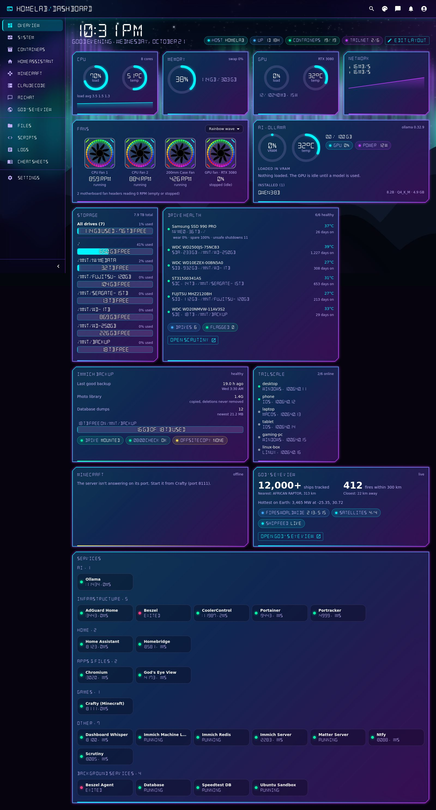
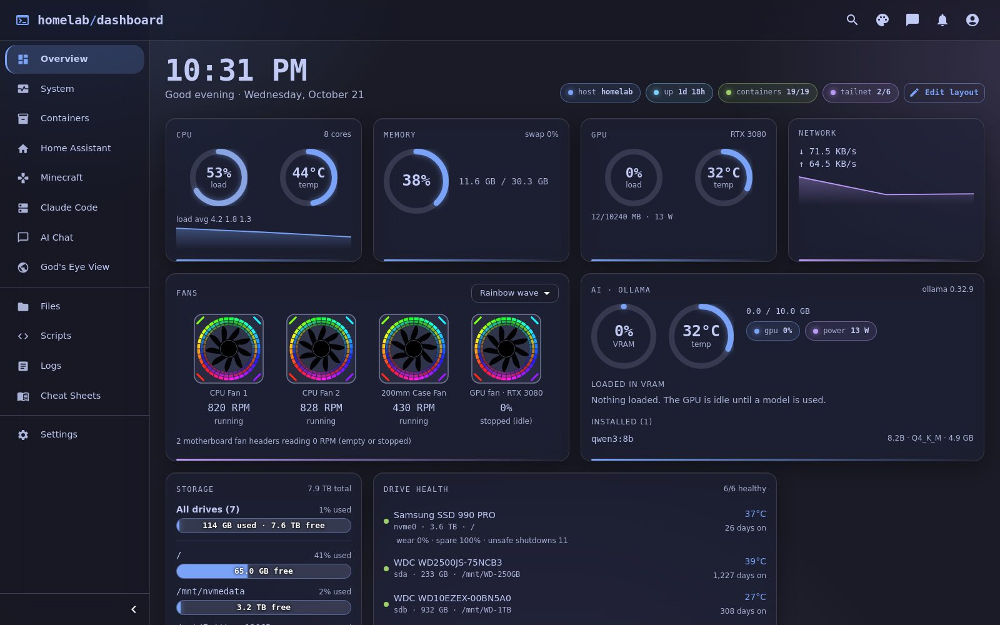
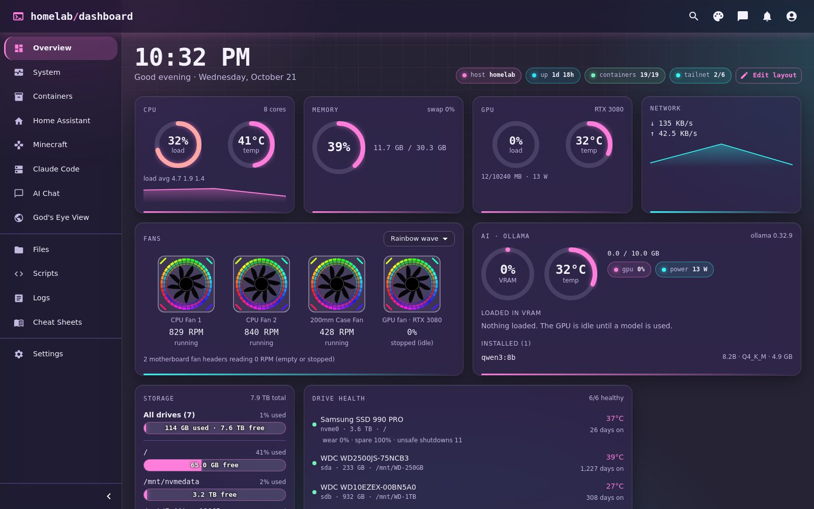
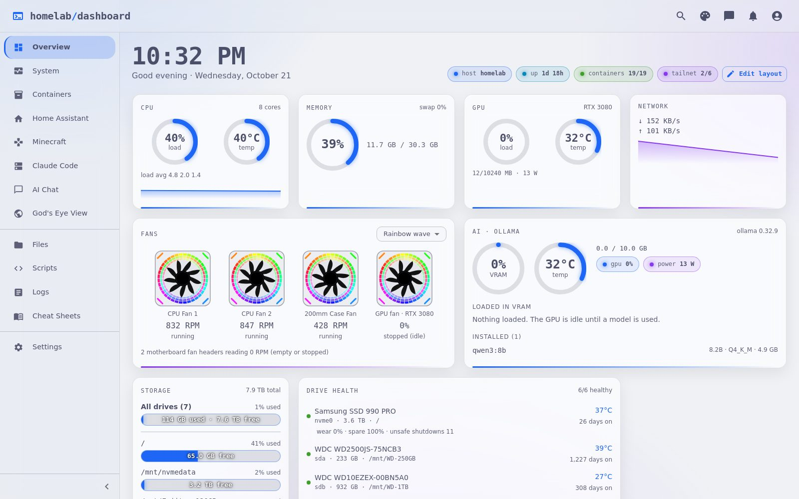
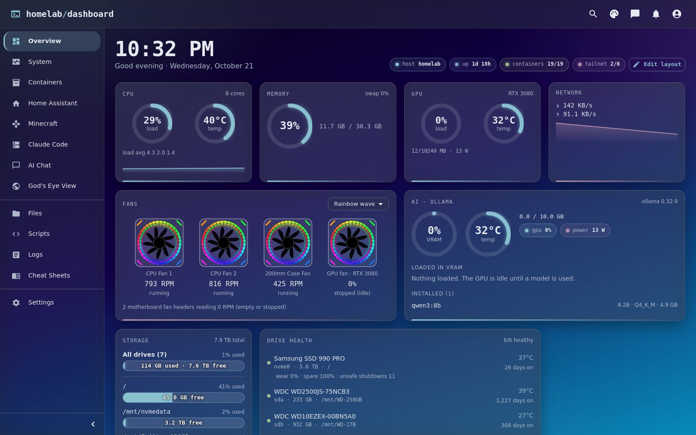
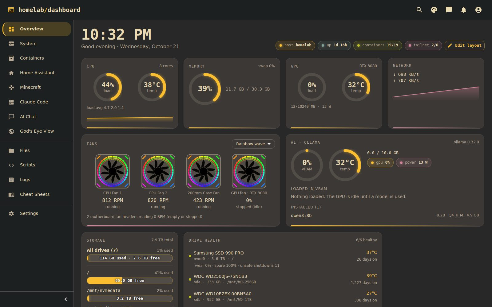
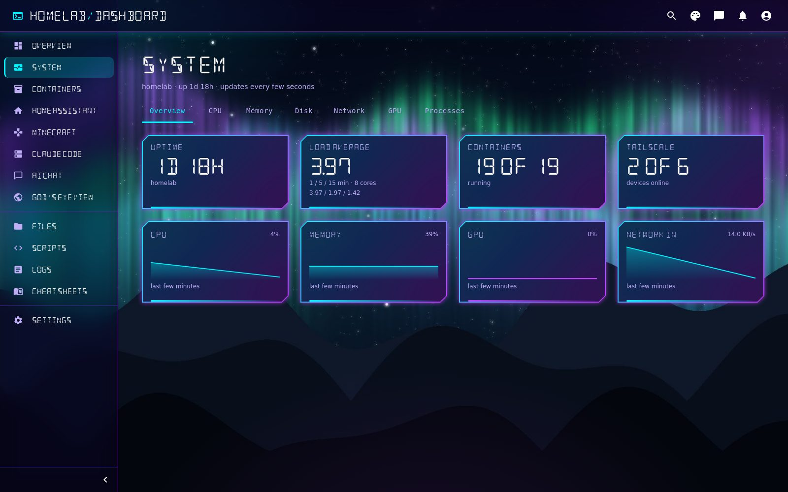
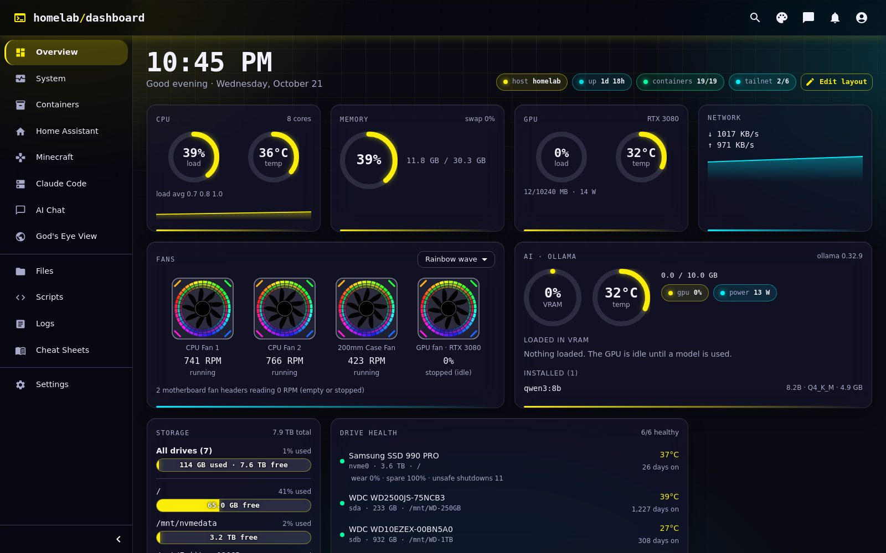
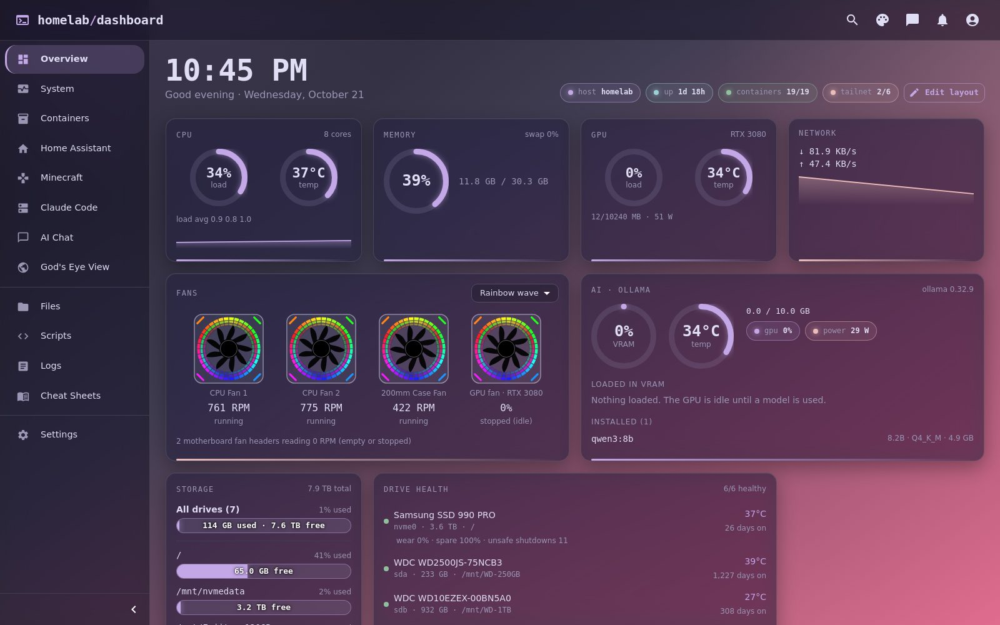
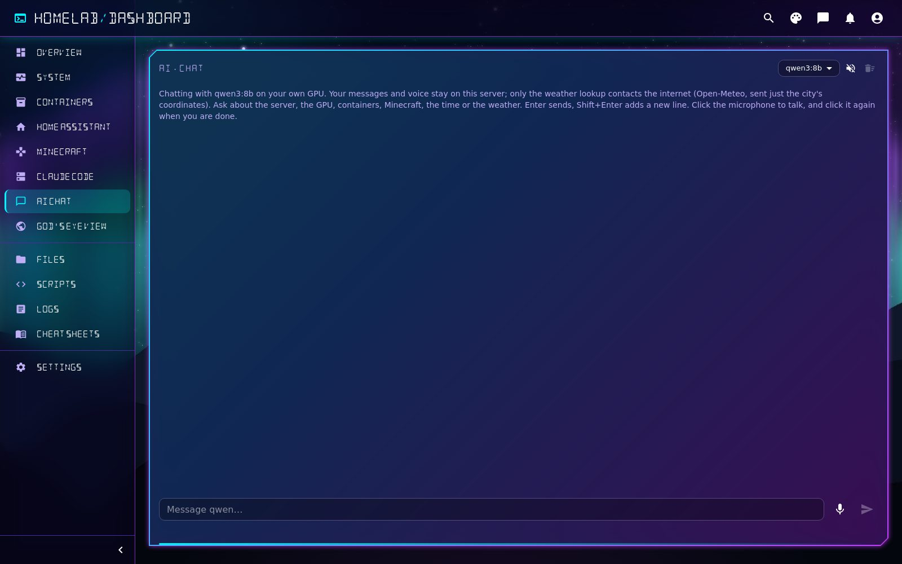

# Homelab Dashboard

A self-hosted dashboard for a single Linux homelab server. It has a FastAPI backend that reads the machine directly
(psutil, the Docker socket, `nvidia-smi`, systemd) and a React + MUI frontend with themes, wallpapers and
drag-to-reorder tiles.



> **No login.** Anyone who can reach the ports can see the server's stats, logs, files and containers. Run it only
> on your LAN or behind a VPN such as [Tailscale](https://tailscale.com). Never port-forward it to the internet.

## What's in it

| Page | What it shows |
|------|---------------|
| **Overview** | CPU, memory, GPU, network, fans, storage, drive health, backups, Tailscale, services grid with health checks, plus a "Needs attention" banner |
| **System** | Detailed host stats and top processes (command lines hidden on purpose) |
| **Containers** | Docker containers, state and resource use |
| **Home Assistant** | Entities grouped by device (needs a long-lived token) |
| **Minecraft** | Server status ping, players, java process stats, mods, log tail |
| **Claude Code** | Status of the installed `claude` CLI |
| **AI Chat** | Streaming chat with a local [Ollama](https://ollama.com) model, tool calls for live server data, optional voice input through Whisper |
| **Files / Scripts / Logs** | Read-only browsing; anything that looks like a password or token is masked |
| **Cheat Sheets** | Renders one Markdown file per service from a folder you choose |
| **Settings** | Theme, wallpaper, zoom, browser alerts |

Every integration is optional. If something isn't installed (no GPU, no Ollama, no Minecraft), its tile says so
instead of breaking the page.

## Screenshots

Fourteen themes, each with optional glass panels and an ambient background. Pick a wallpaper or upload your own.

| | |
|---|---|
|  **Tokyo Night** |  **Synthwave '84** |
|  **Catppuccin Latte** (light) |  **Nord** + Cyber Grid wallpaper |
|  **Gruvbox**, glass off |  **System** page, Neon HUD |
|  **Cyberpunk** |  **Rosé Pine** + Rose Dawn wallpaper |
|  **AI Chat** with a local model | |

## Requirements

- Linux (tested on Ubuntu 24.04)
- Python 3.10+ and Node.js 18+
- Docker (for the Containers page and the services grid)
- Optional: NVIDIA GPU + driver, Ollama, [Scrutiny](https://github.com/AnalogJ/scrutiny), Home Assistant, a Minecraft server

## Quick start

> Using Claude Code? Open [`SETUP-WITH-CLAUDE.md`](SETUP-WITH-CLAUDE.md), paste the prompt into Claude, and it walks
> you through all of this.

```bash
git clone https://github.com/Dsmithdad/homelab-dashboard.git
cd homelab-dashboard

# Backend
cd backend
python3 -m venv .venv
.venv/bin/pip install -r requirements.txt
cp .env.example .env            # then edit .env; every setting is optional
.venv/bin/uvicorn app.main:app --host 0.0.0.0 --port 8000

# Frontend (second terminal)
cd frontend
npm install
CI=false npm run build
npx serve -s build -l 3001
```

Open `http://<server-ip>:3001`. The frontend finds the backend at `http://<same host>:8000` automatically.

Your user needs to read the Docker socket: `sudo usermod -aG docker $USER`, then log out and back in.

## Run it at boot (systemd)

Templates are in [`deploy/`](deploy/). Replace `YOUR_USER` and `/opt/homelab-dashboard` with your values, then:

```bash
sudo cp deploy/*.service /etc/systemd/system/
sudo systemctl daemon-reload
sudo systemctl enable --now homelab-dashboard-backend homelab-dashboard-frontend
```

The backend unit loads `backend/.env` through `EnvironmentFile=`. After you edit `.env` or any backend code, restart it
with `sudo systemctl restart homelab-dashboard-backend`. Frontend changes only need `CI=false npm run build`.

## HTTPS (needed for the microphone and browser alerts)

Browsers only allow the microphone and notifications on https. The simplest way to get https is Tailscale Serve:

```bash
sudo tailscale serve --bg --https=443 http://127.0.0.1:3001
sudo tailscale serve --bg --https=443 --set-path=/api http://127.0.0.1:8000/api
```

Then open `https://<machine>.<tailnet>.ts.net`. On https the frontend calls `/api` on the same origin.

## Configuration

- **`backend/.env`**: integrations and paths. [`backend/.env.example`](backend/.env.example) lists every setting
  with its default.
- **`data/services.json`**: per-container overrides for the services grid, for example
  `{ "my-container": { "name": "AdGuard", "port": 3000, "scheme": "http", "group": "infra", "hide": false, "probe_port": 80 } }`.
- **`data/ignored-containers.txt`**: containers that are stopped on purpose and shouldn't raise "Needs attention".
- **`data/ignored-drives.txt`**: drive WWNs whose Scrutiny warnings you've already reviewed.

The `data/` files are re-read on every request, so edits apply without a restart.

### Optional extras

- **Voice input**: `docker compose -f voice/docker-compose.yml up -d` starts a local Whisper server (NVIDIA GPU,
  about 1 GB VRAM) on `127.0.0.1:8100`.
- **Wallpapers**: gradient wallpapers plus five images (Galaxy, Retro Synthwave, Cyber City, City Dusk, Aurora Peaks)
  are built in, and Settings → Appearance lets you upload your own. To ship another image with the app, put the `.jpg`
  in `frontend/public/wallpapers/` and add an entry to `frontend/src/wallpapers.js`, for example
  `{ id: 'img-mine', name: 'Mine', css: "url(/wallpapers/mine.jpg) center / cover no-repeat" }`.

## Project layout

```
backend/app/main.py           FastAPI app
backend/app/api/endpoints_*   one module per page or tile
backend/app/core/config.py    settings
frontend/src/pages/           one file per page
frontend/src/components/dash/ Overview tiles
data/                         editable overrides (see above)
deploy/                       systemd unit templates
voice/                        Whisper speech-to-text compose file
```

## License

MIT, see [LICENSE](LICENSE). The DSEG font is under the SIL Open Font License
([`frontend/src/fonts/DSEG-LICENSE.txt`](frontend/src/fonts/DSEG-LICENSE.txt)).
